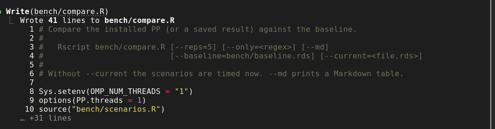

## 05.10.2026


Ich habe Claude in Opus 5.5 im **xhigh**-Modus gestartet. **xhigh**, das ist, wie
sehr sich Claude anstrengt, und ich hoffe, dass damit korreliert, dass er möglichst keinen
Schwachsinn macht. Auf die Frage, womit wir starten, hat er geantwortet,
dass wir zuerst mal den neuesten Branch von Jan holen und mergen müssen (ich dachte,
das hätte ich schon gemacht, aber gut) und dann mal `testthat` installieren
und Benchmarks machen, wie lang was dauert, um dann nachher vergleichen zu können,
wie viel schneller wir geworden sind. Claude meinte, ein Quick-Fix der wirklichen
Probleme ist keine gute Idee, weil man am Ende eh alles umschreiben muss. Yay. 
Claude ist sehr busy. Er macht jetzt offensichtlich einen "bench"-Folder -- 
vermutlich, um darin die Benchmarks zu rechnen.



Die einzelnen Funktionen werden durchprobiert und die unterschiedlichen
Laufzeiten notiert. Eine Zusammenfassung gibt @tbl-laufzeiten. Diese 
[gt](https://gt.rstudio.com/)-Tabelle hat mir Claude erzeugt. 
Interessant ist, dass MAP und EAP schneller konvergieren, vor allem, wenn ein Rateparameter
im Spiel ist (siehe 3-PL-Modell).
Ist auch nicht ganz unlogisch: Ein Prior stabilisiert immer und biegt vermutlich auch eine
etwas seltsame Likelihood so zurecht, dass auch die einfachen Algorithmen schnell konvergieren.
Besonders auffällig ist natürlich, dass das 3-PL-Modell immer die maximale Anzahl
an Iterationen braucht. 

Warum ist das so?

1. Für einige gibt es keinen endlichen MLE-Schätzer. Das kostet Iterationen und 
ergibt dann ein NaN. Das muss später auch behoben werden!
2. Fisher-Scoring springt hin und her, weil die Likelihood sehr flach ist $\rightarrow$
dadurch wird die Maximalanzahl an Iterationen ausgeschöpft. Das ist insbesondere
deshalb eine Problem, weil nicht pro Person optimiert wird und deshalb
alle Personen in diesen langen Iterationen gefangen sind.

::: {#tbl-laufzeiten}

```{=html}
<iframe
  src="media/laufzeiten_baseline.html"
  title="Laufzeiten Baseline"
  style="width: 100%; height: 1530px; border: none;">
</iframe>
```

Laufzeiten der Baseline-Messung.

:::


## 06.10.2026

So, nachdem die alten Funktionen ein letztes Mal angeworfen wurden, um die Laufzeit
zu ermitteln, werden die Änderungen vorbereitet.
Claude ist gerade dran, z. B. unnötige C++-Exporte rauszunehmen und 
kompilierten Dateien zu gelöscht. Offensichtlich waren C++-Funktionen
für R exportiert, die aber dann nie aufgerufen wurden.
Es hat ein bisschen was von "abschleifen, bevor die neue Farbe aufgetragen wird".


## 09.10.2026

Was Claude auch noch will, ist eine Bestandsaufnahme: Was funktioniert, was
funktioniert nicht? Dafür schreibt er kurz zusammengefasst Funktionen
in R, die die zu implementierenden Funktionen "imitieren". Also es wird
z.\ B. die Likelihood via Grid approximiert und so der MLE-Schätzer ermittelt.
Das ist natürlich eine gute Idee. Diese Funktionen könnte man auch gut und gerne
nehmen. Diese sind aber vermutlich "zu langsam" - halt je nachdem, wie man es sieht.
Wenn man eh Zeit hat, wäre es ein bissi wurscht. Aber wir haben keine Zeit!
Mit diesen Funktionen ermittelt Claude jetzt mal, welche von den aktuellen Funktionen
die richtigen Werte ausspuckt. @tbl-schaetzer-kontrolle und @tbl-schaetzer-kontrolle2
hat Claude dankenswerterweise erstellt. Diese zeigen, 
dass einerseits die Standard-Errors tw. "daneben" sind, der Jackknife und die Plausible Values 
gar nicht funktionieren (wenn sie aus der Posterior direkt gezogen werden)
und dass die Optimierung tw. suboptimal verläuft, weil der Algorithmus hin- und herpendelt.
Er kann sich nicht entscheiden!
Personfit-Statistiken gibt es offensichtlich noch nicht für Tests, die sowohl dichotome
als polychotome Items haben -- okay, damit kann man leben. Beim GPCM wird bei
Infit / Outfit laut Claude offensichtlich immer mit Slope 1 gerechnet, also damit
eigentlich ein PCM. Den Messtheoretiker wird es freuen ;-). 


::: {.panel-tabset}


### 1-4PL und GPCM

::: {#tbl-schaetzer-kontrolle}

```{=html}
<iframe
  src="media/schaetzer_kontrolle.html"
  title="Kontrolle der Parameterschätzungen"
  style="width: 100%; height: 730px; border: none;">
</iframe>
```

Erwartungstreue: Modelle $\times$ Schätzer 

:::


### JK, PV, Fit


::: {#tbl-schaetzer-kontrolle2}

```{=html}
<iframe
  src="media/schaetzer_kontrolle2.html"
  title="Weitere Kontrollen"
  style="width: 100%; height: 944px; border: none;">
</iframe>
```

Erwartungstreue: Modelle $\times$ Schätzer Fortsetzung

:::

:::

Das dürften alle Vorbereitungen sein, bevor wir nun 
direkt in den Code reingrätschen und die Sachen
richtiger machen als zuvor! 
