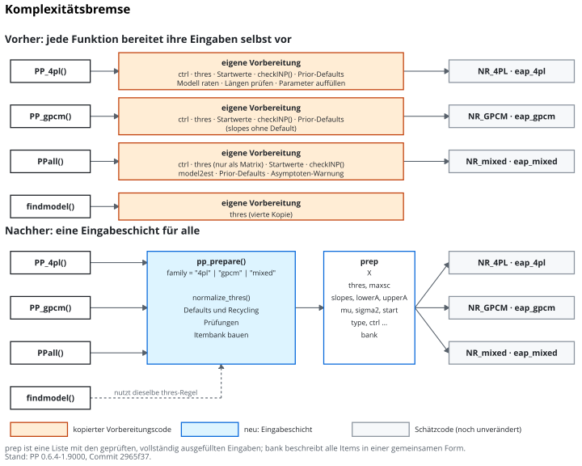
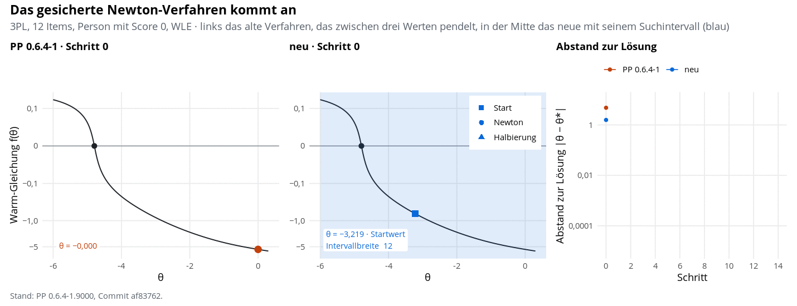
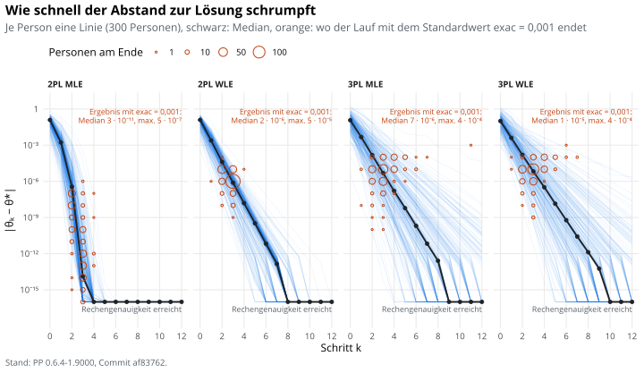
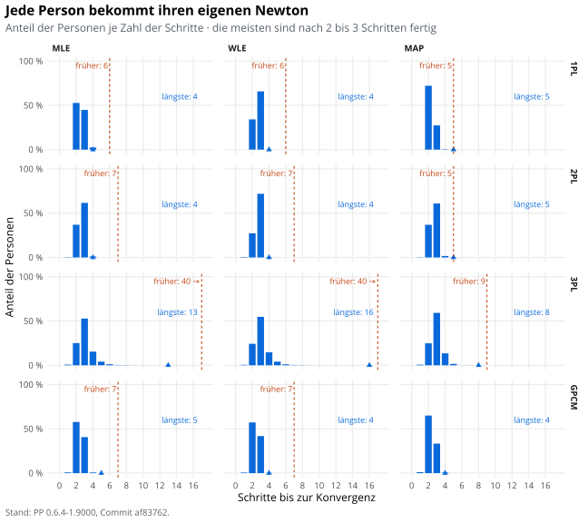

## 10.10.2026

Ich lasse mir gerade von Claude die neu erstellte Funktion `pp_prepare` erklären,
die zentral die Datenaufbereitung übernimmt. Also es wird eine Datenmatrix
und Infos zu den Parametern übergeben -- dann werden die Daten
so aufbereitet, dass sie optimiert werden können.
In der letzten veröffentlichten Version des Packages 
wurden die Daten für jede Funktion separat aufbereitet, jetzt 
gibt es **eine** zentrale Funktion, die das macht.
@fig-komplexbrms zeigt diese Idee.

::: {#fig-komplexbrms}

Komplexitätsbremse. Der Wildwuchs an Code wird vereinheitlicht!
:::

`pp_prepare` läuft nur intern ab -- wird also nicht durch den "User" aufgerufen (typischerweise)
und auch der jetzige Output wird sich noch deutlich verändern, sagt Claude.

Und schon sind die nächsten Schritte dran: Zuerst wird die Simulationsfunktion neu gemacht.
Dann wird endlich der C++-Kern angegriffen, um einige Probleme zu lösen.

### Newton sprang hin und her

Wenn Newton bei einem Modell mit Rateparameter alleine zugange war, fand er 
in bestimmten Fällen mehrere Lösungen attraktiv. 
Das sollte nicht passieren. Der Algorithmus ist dazu da, möglichst schnell das 
Minimum zu finden. Das passt auch für 1-PL- und 2-PL-Modell wunderbar.
Doch sobald der Rateparameter oder die "Upper Asymptote" hinzukommen, wird
es **dangerous**. Das Problem ist einerseits, dass die Prozedur in manchen Fällen nie 
konvergiert und andererseits, dass sie "die ganze Partie aufhaltet", wie man sagt.
Denn bisher wurde nicht personenweise optimiert, sondern pro Item.
Das verursachte lange Laufzeiten. @fig-newtonhinher zeigt, wie es vorher war (das Herumspringen)
und wie es jetzt ist. Claude hat mir vorgeschlagen, salopp gesagt:
Wenn es so ausschaut, als ob der Newton-Algo Scheiße baut, dann switche auf die [bisection method](https://en.wikipedia.org/wiki/Bisection_method). Der konvergiert immer fix, 
aber halt nicht so flott. Wir sind aber jedenfalls flotter als ein nerviges
Herumgehüpfe bis zu den maximalen Iterationen. Denn wenn man es gut meint
und dem Algorithmus Zeit geben will und daher die maximalen Iterationen hochschraubt,
wartete man bis jetzt zum Sankt-Nimmerleins-Tag, um dann mit einem eher zufälligen
Punktschätzer dazustehen.

::: {#fig-newtonhinher}

Schluss mit Hin- und Herspringen!
:::

### Geschwindigkeit der Konvergenz

@fig-konvergenz zeigt, dass die Neuimplementierung dazu führt, dass sehr schnell der optimale
Wert gefunden wird bzw. eben ein Wert, der nah genug dran ist 
(der Parameter `exac` legt fest, was nahe genug ist). Zu sehen sind ein 2-PL- und ein 3-PL-Modell,
jeweils mittels MLE und WLE geschätzt. Die blauen Linien beschreiben den 
Verlauf des Abstands zum optimalen Wert, wenn man immer die maximalen Iterationen
durchführt. Damit erkennt man gut, wie schnell das beim 2-PL-MLE läuft!
Die roten Kreise markieren die Durchläufe (je größer desto mehr), bei denen das KOnvergenzkriterium 
`exac = 0.001` erfüllt war. Bei den meisten Pattern konnte bereits nach 2 bis 3
Iterationen abgebrochen werden, weil dann sich die Schätzung nicht mehr wesentlich veränderte.
Auch beim 3-PL-Modell dauert es nicht lange. Wenige Iterationen reichen, um extrem
nahe an den optimalen Wert heranzukommen.

::: {#fig-konvergenz}

Geschwindigkeit der Konvergenz!
:::

### Vergleich mit früher

@fig-newton-vn zeigt die Anzahl der Iterationen im Vergleich zum früheren Package.
Es muss jetzt weniger iteriert werden, weil jede Person einzeln optimiert wird.
Wir sind schneller! Yay!

::: {#fig-newton-vn}

Vorher-Nachher-Vergleich. Jetzt brauchen wir wesentlich weniger Iterationen.
:::

Na gut. Als Nächstes kommt dann der Umbau von Jackknife und Plausible Values.
Ob diese Funktionen schon mal jemand verwendet hat? Ich das schöne neue package
schon vor mir sehen! Jetzt ist es nicht mehr weit!

