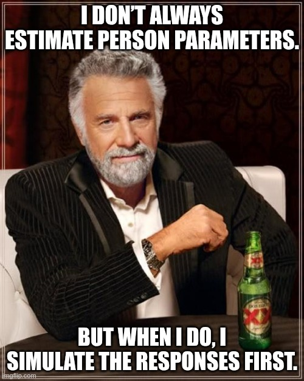

Jetzt ist die neue Version des PP-Package fertig. 
Personenparameter kann man nun in Hochgeschwindigkeit schätzen -- so 
flott ging das noch nie. Anstatt hier weiter
über alle Änderungen zu berichten (es wurden weitere kleine
Probleme behoben), starten wir mit einer kleinen Übersicht zum Package.


Wie jeder gute Methodenentwickler haben wir keine Erhebungsdaten einfach so herumliegen.
Wir versuchen ja auch nicht mit den entwickelten Methoden unsere Probleme zu lösen. 
Es ist nicht mal zwingend notwendig, dass die Methoden überhaupt derzeit existierende, reale Probleme lösen. Oft muss man zur entwickelten Methode erst das richtige Problem finden.
Wenn man also keine Daten hat, dann muss man sich welche simulieren! 
Wie sehen typische Daten aus, die an IRT-Modelle gefüttert werden?
Im einfachsten Fall hab ich dichotome Daten, also 0/1 -- z.\ B. 
richtig und falsch aus einem psychologischen Test.
Werden Fragebögen ausgefüllt, dürfen sich die
Testpersonen oft innerhalb von 4 oder mehr Kategorien entfalten. 


## Dichotome Daten

Wir beginnen mit dichotomen Daten. Jede Variable hat also nur 2 Ausprägungen. 
So sehen typischerweise auf "richtig" und "falsch" codierte
Items aus einem Leistungs- oder Intelligenztest aus.


### Simulation 2-PL-Modell




Im ersten Schritt sollten die Itemparameter geschätzt werden.
Dazu nimmt man gerne Packages wie [eRm](https://cran.r-project.org/web/packages/eRm/index.html)
(spezialisiert auf Rasch-Modelle (1-PL))
oder [andere](https://cran.r-project.org/web/views/Psychometrics.html).
Das heißt, wir gehen schon davon aus, dass wir "fertige" Itemparameter haben. Deren Wert
wird als fixiert angenommen; der Standarderror der Itemparameter, 
also wie präzise sie geschätzt wurden, wird im PP-Package nicht berücksichtigt^[Aber vielleicht eines Tages ... ].
Zumeist bringen Packages, die solche Modelle fitten, auch selbst schon Methoden mit, um 
Personenparameter zu schätzen. Wieso sollte also jemand das PP-Package verwenden?

1. Es geht viel (viel) **schneller**!
2. Das PP-Package ist extrem cool, denn soviel wir mitbekommen, sind 96\ % 
der Erwähnungen auf Social Media entweder **neutral oder positiv**^[Ich gebe es zu, diese Zahlen sind erfunden; das war aber notwendig, um diesen Insider-Joke zu bringen. Hätte ich es nicht gemacht, wäre vielleicht die Grafikkarte durchgebrannt.]!
3. Es sind viele unterschiedliche Schätzmethoden implementiert!
4. Man kann auch die Personenparameter für Pattern schätzen, die in den Originaldaten
(zum Schätzen des gesamten IRT-Modells) nicht vorkamen. 
Wenn, zum Beispiel, ein etablierter Test mit bekannten Itemparametern neu vorgegeben wird, 
können natürlich **neue Pattern** resultieren, die so noch nie vorlagen. 
Für diese will man natürlich auch einen Personenparameter!


```{r}
#| echo: true
#| 
library(PP)

set.seed(10)

# das sind unsere Parameter
diffpar <- sort(round(seq(-4,4, length.out = 20),2))
alphas  <- round(rnorm(20, 1, 0.12), 2)
ability <- rnorm(5000)

data_2pl <- PP::sim_4pl(beta = diffpar, 
  alpha = alphas,
  lowerA = 0, 
  upperA = 1, 
  theta = ability)

head(data_2pl,3)

```

```{r}
#| echo: true
#| fig-width: 6
#| fig-height: 5
#| label: fig-randsumme
#| fig-cap: Randsummen gegen Itemparameter. Schaut alles gut aus.
plot(diffpar, colSums(data_2pl))
```

Das Ergebnis der Simulation ist im Wesentlichen eine numerische Matrix.
In diesem Fall dichotom. Eine schnelle Überprüfung wie in @fig-randsumme zeigt,
dass mit der Simulation alles passt, also zumindest die Schwierigkeitsparameter. :-)


### Schätzen der Personenparameter

Wir haben nun die Daten und die Parameter der Items und
wollen die Personenparameter schätzen. Das kann man auf
unterschiedliche Art und Weise machen.
Als Default fungiert der `WLE`-Schätzer nach Warm. Er liefert
auch vernünftige Schätzer für die Extremfälle: "alle Items gelöst"
und "kein Item gelöst". `MLE` hat genau bei diesen Pattern verständlicherweise
ein Problem, denn letztendlich weiß man von diesen "extremen" Personen bloß, dass
sie zu fähig oder zu unfähig für den Test waren. Die praktische Konsequenz wäre, wenn
 ich für diese Personen vernünftig messen will, einen schwierigeren oder
 leichteren Test vorzugeben, um vernünftige Messwerte zu bekommen. 

```{r}
#| echo: true
#| 
### WLE 

perspar_2pl_wle <- PP::PP_4pl(data_2pl, 
  thres = diffpar, 
  slopes = alphas, type = "wle")

head(perspar_2pl_wle$estimates, 4)

### MLE
perspar_2pl_mle <- PP::PP_4pl(data_2pl, 
  thres = diffpar, 
  slopes = alphas, type = "mle")

head(perspar_2pl_mle$estimates, 4)
```

Neu im PP-Package: Es gibt ein paar vorgefertigte **Grafiken**!
Zugegebenermaßen ist das jetzt nicht das wichtigste Feature, aber,
um auch hier was Schönes herzeigen zu können, gibt es jetzt 
eine **plot**-Funktion, die je nach `which`-Eingabe etwas anderes zaubert!
Basis dafür ist das tolle [tinyplot](https://cran.r-project.org/web/packages/tinyplot/index.html)-Package! @fig-prec zeigt uns Infos zu den Personen und Items und SE -- 
noch nichts zu sehen von Personfit (der wurde ja auch noch nicht berechnet).


```{r}
#| echo: true
#| fig-width: 9
#| fig-height: 6
#| label: fig-prec
#| fig-cap: Personenverteilung, Items und Messfehler in einer Grafik. Vermutlich selten notwendig, aber hilft vielleicht dabei, den einen oder anderen Bericht zwar länger, aber weniger langweilig zu machen.
plot(perspar_2pl_wle, which = "precision")
```


### Personfit


Haben sich auch alle Personen instruktionskonform verhalten?
Setzt beim Bearbeiten des Tests Ermüdung ein, oder 
passt das Modell für einzelne Personen nicht, weil sie z.\ B. geraten haben?
Der Personfit gibt uns Auskunft, ob die beobachteten Antwortpattern auffällig sind oder nicht!
Wir könnten die Personfitstatistiken separat erzeugen
via `PP::Pfit`, aber `PP::PPass` macht gleich alles in einem
Aufwasch und wir haben gleich alle Fit-Indizes mit dazu!
Auch bei diesem simulierten Datensatz, bei dem wir wissen,
dass alle simulierten Personen sich gemäß dem 2-PL-Modell (Nullhypothese)
verhalten haben (also niemand tanzt (zu weit) aus der Reihe),
finden wir signifikante Personen^[Wir erwarten rund 250 signifikante Personen bei N = 5000, wenn wir den Fehler 1. Art bei 5\ % annehmen.]. Tja, das ist Statistik!

```{r}
#| echo: true
#| 
ass_2pl <- PP::PPass(data_2pl,
  thres = diffpar, 
  slopes = alphas)
```


Nur hier als Demonstration, was man sich unter problematischen
Pattern vorstellen kann. Die Items sind der Schwierigkeit nach geordnet.
Man würde also annehmen, dass ein Antwortpattern eine Häufung von 1en 
am Anfang hat und dann, später im Test, die 0er das Kommando übernehmen.
Natürlich hängt es von der Personenfähigkeit ab, ob die ungelösten Items
bereits im ersten Drittel losgehen oder erst im letzten.
So ein Pattern wäre jedenfalls sehr unwahrscheinlich 
(wenn der Test eindimensional misst etc.), völlig unabhängig davon,
wie hoch oder niedrig die Personenfähigkeit ist: 00000000001111111111. 


```{r}
#| echo: true

library(data.table)

data_2pl_dt <- data.table(data_2pl)

data_2pl_dt[, problem := frank(-ass_2pl$lzstar)]
problembaeren <- data_2pl_dt[problem %in% 5000:4996, !"problem"]

siehtmanwas <- apply(problembaeren, 1, function(x) paste0(x, collapse = ","))
print(siehtmanwas)


```

Jetzt will man sich die Übeltäter auch grafisch ansehen.
Das funktioniert mit `plot` ganz automatisch, wenn man
alle Personen gleichzeitig sehen will, 
wie in @fig-fit dargestellt.
Wenn ich mir aber einzeln ansehen will, bei welchen
Items die Personen unerwartet geantwortet haben, ist
`which = 'profile'` die richtige Option. @fig-prof zeigt
den Outcome. Es wurden für diese Grafik die 3 auffälligsten Personen
laut $lz^*$ dargestellt und jene Person, die am wenigsten auffällig war
(im letzten Panel zu sehen). 
Rein qualitativ sehen auch die als auffällig gelabelten
Personen nicht brutal abweichend aus -- Grund ist vermutlich,
dass modellkonform simuliert wurde.


```{r}

problem_und1_zeilennummer <- data_2pl_dt[, which(problem %in% c(5000:4998))]

null_problemo <- data_2pl_dt[, which.min(problem)]
drei_probleme_und_ein_nichtproblem <- c(problem_und1_zeilennummer, null_problemo)

```
::: {.panel-tabset}


#### which = "fit"

```{r}
#| echo: true
#| fig-width: 9
#| fig-height: 6
#| label: fig-fit
#| fig-cap: Alle Personenparameter geordnet nach Estimate und lz*
#| 
plot(ass_2pl)
```

#### which = "profile"

```{r}
#| echo: true
#| fig-width: 9
#| fig-height: 7
#| label: fig-prof
#| fig-cap: Hier kann man sich die garstigen Profile ansehen.
#| 
plot(ass_2pl, which = "profile", 
person = drei_probleme_und_ein_nichtproblem)
```
:::


## Ordinale Daten


Die Ordinalskala ist das Stiefkind unter den Skalenniveaus.
Sie wird entweder behandelt wie eine Nominalskala, indem
profane Balken- oder, noch viel schlimmer, **Tortendiagramme** (Triggerwarnung!)
erzeugt werden, die nicht nur von schlechtem grafischem Geschmack
zeugen, sondern auch noch die natürlich gegebene Reihenfolge der Kategorien zerstören.
Die "Mutigeren" machen aus der Ordinalskala gleich eine Intervallskala,
denn: "Warum nicht?". Sind ja auch nur Zahlen. Ein bisschen Addieren oder
Subtrahieren tut ihnen ja nicht weh. Manchmal sieht man sogar
echte Psychometriker, wie sie ordinale Daten dichotomisieren, um
ein 1-PL- oder 2-PL-Modell anzuwenden. 
Daher z'fleiß für alle Hater ordinaler Daten hier: **Partial Credit Model**.
Es ist ein bisschen das hässliche Gesicht der ordinalen Modelle, denn ich muss
zugeben, das [Graded Response Model](https://onlinelibrary.wiley.com/doi/10.1002/j.2333-8504.1968.tb00153.x) von der hoch zu verehrenden
[Fumiko Samejima](https://en.wikipedia.org/wiki/Fumiko_Samejima) ist schöner, logischer,
besser zu erklären und eingängiger. Bei manchen Lesern dreht sich schon alles im
Kopf und sie wenden sich angewidert ab, 
denn ja: Bei ordinalen Daten muss man *wählen*, welches Modell man nimmt.
Ok, das "muss" man bei dichotomen Daten auch, aber da hat man das Gefühl, es kommt
immer was Cooles dazu, wenn man von 1- auf 4-PL hochzählt:
 *Trennschärfe* klingt würzig und man erinnert sich 
an die erste selbst gerechnete Faktorenanalyse und 
deren Ladungen (auch wenn es nur eine PCA war), *Rateparameter* klingt, als könne
man columbohaft die Schummler und Glückskäfer unter den Testpersonen entlarven und erst
der unschätzbare (haha) 4. Parameter beim 4-PL-Modell bringt all jene zum Schmunzeln,
die auch schon mal ein leichtes Wort im letzten Versuch nicht fanden und so ihren 
100-Tage-Wordle-Streak zerstörten. Aber bei ordinalen Modellen "darf" man sich
schon mit der Entscheidung quälen, wie die Kategorienwahrscheinlichkeiten
gebildet werden (z.\ B. kumulativ vs. benachbarte Kategorien).
Diese Wahl wurde aber ohnehin schon bei der Schätzung der Itemparameter getroffen.
Fiel sie nicht zugunsten des (G)PCM aus, 
dann muss man hier eh nicht weiterlesen^[Für GRM kommen auch mal Personenparameter. Ich schwöre!]. 


### Simulation 

Also die Simulation läuft im Grunde genau wie bei den
dichotomen Modellen. Man muss die Schwellenparameter kennen
und, falls es einen Slope (alpha) gibt, den auch. 
Dann ist das auch ruckzuck erledigt.

```{r}
#| code-fold: true
slopes <- c(0.5, 1, 1.5, 1.1, 1, 0.98)

thres <- rbind(0, matrix(c(-2, -1.23, 
                            1.11, 3.48, 
                            1, 2, 
                            -1, -0.2, 
                            0.5, 1.3, 
                            -0.8, 1.5),
                          nrow = 2))

daten <- PP::sim_gpcm(thres = thres, 
  alpha = slopes, theta = rnorm(1000))

head(daten, 5)

```

### Personenparameter und Personenfit

Hier berechnen wir die Personenparameter und den Personenfit
getrennt. Der Output ist nicht ganz so pretty. 
`PPass` hilft natürlich dabei, einen schönen Datensatz zu
bekommen, den man gleich weiterverarbeiten kann!
Aber zumindest ist hier mal eine schöne `summary`-Funktion
im Einsatz. Plots funktionieren wieder genauso wie oben, 
die turne ich jetzt nicht auch noch vor -- also bitte selbst
anfertigen.

```{r}
# WLE estimates
res_gpcm <- PP::PP_gpcm(daten, thres = thres, slopes = slopes)
summary(res_gpcm)
```

`Pfit` liefert nun die Fit-Indizes, die man sich wünscht. Infit und Outfit,
die beiden wohl bekanntesten Personfitstatistiken, wurden in diesem Fall gewählt. 
Wen das auch inhaltlich interessiert, dem sei diese Seite
empfohlen: [https://www.rasch.org/rmt/rmt162f.htm](https://www.rasch.org/rmt/rmt162f.htm).
Optisch ist die Seite in den 90ern stecken geblieben -- 
auch das Navigieren auf der Seite scheint eine Metapher für Homers Odyssee zu sein,
allerdings, wenn man zwischen Skylla und Charybdis richtig abgebogen ist, 
bietet sie eine Vielzahl an Informationen zum Thema IRT an. 


```{r}
fitti <- PP::Pfit(res_gpcm, fitindices = c("infit", "outfit"))
str(fitti)
```

Ja, das war's zum `PP`-Package. Jetzt ist die Frage, was man noch 
ergänzen könnte, um den Funktionsumfang zu erweitern.
Also vielleicht gibt es in Zukunft noch mehr PP -- oder auch nicht. 


