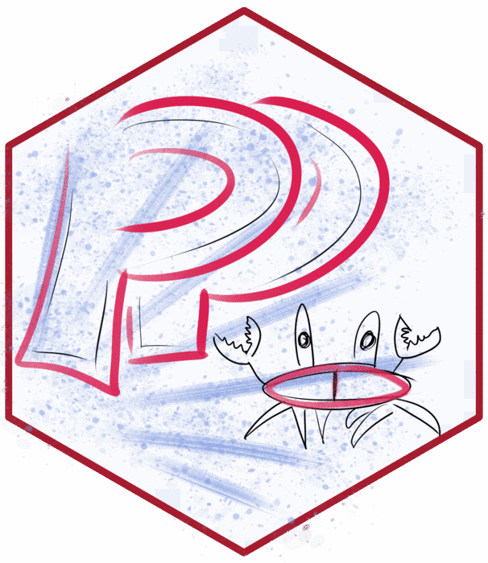
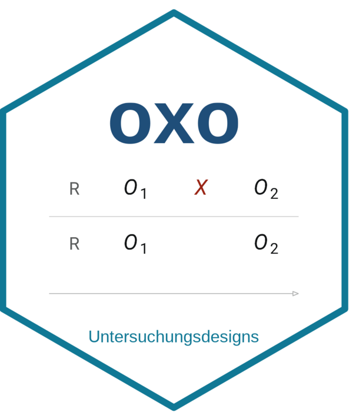
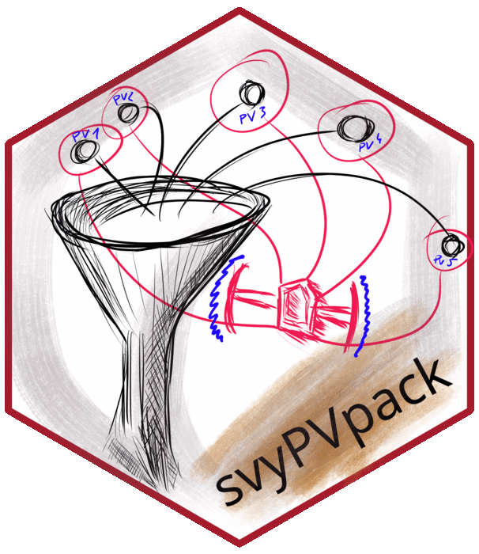

Vier R-Packages: drei rund um Item Response Theory und Large Scale Assessments,
dazu oxo für Diagramme von Untersuchungsdesigns.
Der Code unten ist jeweils ein kurzes Beispiel aus der Dokumentation.

<!-- Status bitte prüfen: PP auf CRAN, oxo, mcIRT und svyPVpack nur auf GitHub -->

::: {.pkg-card style="--pkg-accent: rgb(215, 40, 96);"}
::: {.grid}
::: {.g-col-12 .g-col-md-4}
[{.pkg-hex fig-alt="Hexsticker PP"}](https://cran.r-project.org/package=PP)
:::

::: {.g-col-12 .g-col-md-8}
### PP {.unnumbered .unlisted}

   [GitHub](https://github.com/manuelreif/PP){.pkg-badge}

Das PP package schätzt Personenparameter für IRT-Modelle wie das Rasch-Modell
(1-PL), 2-PL, 3-PL, 4-PL und das Partial Credit Model, mittels MLE, WLE, MAP,
EAP oder robusten Methoden. Zusätzlich können unterschiedliche Person-Fit-Indizes
berechnet werden, wie Infit, Outfit oder die lz-Statistik. Es ist aus der Idee
entstanden, mit vorliegenden Itemparametern Personenparameter berechnen zu können,
unabhängig vom Software-Package, das die IRT-Analyse durchgeführt hat.

```r
library(PP)

data(fourpl_df)
diff_par  <- attr(fourpl_df, "diffpar")
slope_par <- attr(fourpl_df, "slopes")

res1plmle <- PP_4pl(respm = itmat,
                    thres = diff_par,
                    slopes = slope_par,
                    type = "mle")
```

[ Blogserie zur Überarbeitung](blog.qmd#category=PP)
:::
:::
:::

::: {.pkg-card style="--pkg-accent: rgb(16, 120, 149);"}
::: {.grid}
::: {.g-col-12 .g-col-md-4}
[{.pkg-hex fig-alt="Hexsticker oxo"}](https://github.com/manuelreif/oxo)
:::

::: {.g-col-12 .g-col-md-8}
### oxo {.unnumbered .unlisted}

 [GitHub](https://github.com/manuelreif/oxo){.pkg-badge}

`oxo` zeichnet Untersuchungsdesigns in der Notation von Shadish, Cook & Campbell
(2002): Jede Gruppe ist eine Textzeile wie `"R  O1  X  O2"`, daraus entsteht eine
Vektorgrafik. Das Package ist mit Claude Code entstanden. Das ursprüngliche Ziel war es, 
2 Grafiken im genannten Stil für meine Vorlesungsfolien anzufertigen. 
Daraus entstand, nach vielfachen Iterationen und Anpassungen, das `oxo` 
Package in seiner derzeitigen Fassung.

```r
library(oxo)

ox_design(
  c("NR  O1  X  O2",
    "NR  O1  .  O2"),
  labels     = c("Treatment", "Control"),
  highlight  = "1:X",
  brace      = list(from = "1:O1", to = "1:O2",
                    label = "Diff = O_2 - O_1"),
  arrow      = list(at = "2:O1",
                    label = "selection bias?"),
  note       = c("gets the training",
                 "waiting list"),
  time_label = "time")
```
:::
:::
:::

::: {.pkg-card style="--pkg-accent: rgb(205, 118, 50);"}
::: {.grid}
::: {.g-col-12 .g-col-md-4}
[{.pkg-hex fig-alt="Hexsticker mcIRT"}](https://github.com/manuelreif/mcIRT)
:::

::: {.g-col-12 .g-col-md-8}
### mcIRT {.unnumbered .unlisted}

[GitHub](https://github.com/manuelreif/mcIRT){.pkg-badge}

Das Package schätzt das Nominal Response Model bzw. das Nested Logit Model und
gibt damit einen tieferen Einblick in die Funktionsweise von Multiple-Choice-Items.
Geschätzt wird mit der MML-Methode, mit oder ohne latente Regression.

```r
library(mcIRT)

ParList <- lapply(1:3, function(x) {
  Item1 <- c(c(-2, -1, 1, 2), 
    c(-1.2, 0.3, 0.2, 0.7))
  names(Item1) <- c(paste("zeta", 1:4, sep = ""),
                    paste("lamb", 1:4, sep = ""))
  Item1
})
names(ParList) <- paste("item", 1:3, sep = "")

perp1     <- rnorm(1100, 0, 1)
sim.nrm.1 <- NRM.sim(ParList, perp1)

reshdat1 <- reshMG(sim.nrm.1, items = 1:3,
 correct = rep(0, 3))
res_nrm  <- nrm(reshdat1)
```
:::
:::
:::

::: {.pkg-card style="--pkg-accent: rgb(133, 154, 165);"}
::: {.grid}
::: {.g-col-12 .g-col-md-4}
[{.pkg-hex fig-alt="Hexsticker svyPVpack"}](https://github.com/manuelreif/svyPVpack)
:::

::: {.g-col-12 .g-col-md-8}
### svyPVpack {.unnumbered .unlisted}

[GitHub](https://github.com/manuelreif/svyPVpack){.pkg-badge}

Dieses Package ist im Laufe des PIAAC-Projekts entstanden und erleichtert den
Umgang mit komplexen Surveydesigns und Plausible Values. Die Funktionen stellen
sicher, dass bei der Berechnung der Konfidenzintervalle sowohl der Standardfehler
über Bootstrap bzw. Jackknife (mit dem `survey`-Package) als auch die
Imputationsvarianz berücksichtigt werden. Von einfachen Berechnungen wie Quantilen
bis zu GLMs sind gängige Methoden umgesetzt, die speziell auf diesen
Anwendungszweck zugeschnitten sind.

```r
library(svyPVpack)

data(svy_example1)

res_glm <- svyPVglm(plaus.. ~ otherPlaus.. + age,
                    svy.exrep,
                    placeholder = 1:3)
res_glm
```

[Wiki](https://github.com/manuelreif/svyPVpack/wiki)
:::
:::
:::
